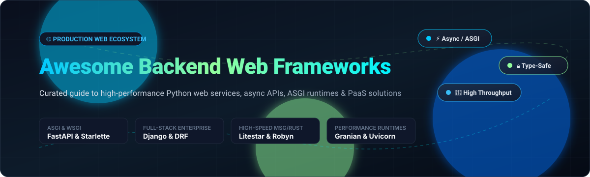

# ⚡ Awesome Backend Web Frameworks

  

  
  
  
  
  
  

---

## 🌟 Top Backend Web Frameworks & Cloud Ecosystem

> **A rigorously curated directory of cutting-edge SaaS platforms and open-source backend web frameworks.**  
> *Focused on Async APIs, ASGI/WSGI servers, type-safe validation, high-throughput microservices, and production-ready Python web services.*  
> 
> 📅 **Last updated: October 2026**

This repository tracks high-performance **SaaS platforms** and **open-source backend frameworks**. These tools empower developers and platform teams to build resilient REST APIs, GraphQL endpoints, and full-stack web applications—ranging from ultra-fast asynchronous micro-frameworks with granular routing control to batteries-included platforms featuring built-in ORM, admin dashboards, and authentication.

Whether you're developing high-concurrency microservices, AI inference endpoints with FastAPI, enterprise APIs with Django REST Framework, or looking for Rust-accelerated ASGI servers like Granian, this guide covers the entire operational spectrum.

---

## 📑 Table of Contents

- [📊 Sector Overview & Market Dynamics](#-sector-overview--market-dynamics)
- [☁️ SaaS & Hosted Deployment Platforms](#️-saas--hosted-deployment-platforms)
- [🐙 Open-Source GitHub Projects](#-open-source-github-projects)
- [📈 Star History](#star-history)
- [💖 Support & Sponsorship](#-support--sponsorship)
- [🤝 How to Contribute](#-how-to-contribute)
- [⚖️ Disclaimer & Engineering Trade-offs](#️-disclaimer--engineering-trade-offs)

---

## 📊 Sector Overview & Market Dynamics

The global cloud **Platform-as-a-Service (PaaS)** and backend application hosting market is estimated at approximately **$140B–$170B in 2025–2026**, projected to grow at a compound annual growth rate (**CAGR of 16–18%**) through 2032. This expansion is powered by the rapid proliferation of containerized microservices, async ASGI backends, real-time streaming, and generative AI API infrastructure.

The sector exhibits **moderate-to-high fragmentation**: while cloud hyperscalers (Amazon Web Services, Microsoft Azure, Google Cloud Platform) dominate raw computing and enterprise infrastructure, the developer-centric backend PaaS layer remains vigorously contested. Mature enterprise stalwarts like Salesforce Heroku compete alongside agile, modern developer-experience platforms like Render, Railway, and framework-tailored clouds such as FastAPI Cloud.

---

## ☁️ SaaS & Hosted Deployment Platforms

Managed cloud environments provide zero-downtime deployment pipelines, automatic SSL, managed relational databases, and auto-scaling for backend web applications.

| Platform | Company Size (Valuation / Revenue) | Starting Paid Tier Pricing | Free Tier / Trial Limits | Description |
| :--- | :--- | :--- | :--- | :--- |
| **[Heroku](https://www.heroku.com/)** | ~$200M+ ARR (Acquired by Salesforce for $212M; Salesforce parent market cap ~$300B+) | $5.00/month (Eco dynos pool) / $7.00/month (Basic dynos) | 30-day trial with credit card verification for eligible programs / No permanent free tier (free dynos retired; requires minimum $5/mo Eco plan with 1,000 pooled hours, sleeps after 30 min idle) | Pioneer PaaS platform providing managed Django, Flask, and Python application runtimes with automated git deployments and managed Postgres. |
| **[Render](https://render.com/)** | $1.5B valuation (~$25M+ ARR, $100M+ Series C) | $7.00/month (Starter instance, 512MB RAM, 0.5 CPU) | Free forever Hobby plan: 750 free instance hours/month, 512MB RAM, 0.1 CPU, 5GB bandwidth/mo, sleeps after 15 min of inactivity (cold start 30–60s); free PostgreSQL database expires after 30 days | Modern cloud platform offering automated builds, background workers, zero-downtime deploys, and managed databases for Python web backends. |
| **[Railway](https://railway.com/)** | ~$120M total venture funding raised (Series B backed by Redpoint) | $5.00/month (Hobby plan base platform fee + usage overages) | Free plan with $1.00/month ongoing non-rollover usage credits (1 vCPU, 0.5GB RAM per service, 1 replica, 3-day logs) + 30-day $5 one-time new account trial credit without credit card | Instant-deploy PaaS for containerized Python backend services and microservices with automatic PR staging environments. |
| **[FastAPI Cloud](https://fastapicloud.com/)** | Venture-backed (Sequoia Capital backed seed/Series A; valuation undisclosed) | $20.00/month per seat (Pro beta plan) | Free forever Hobby plan: 3 apps, 1 custom domain, 0.1 CPU / 512MB RAM (burst to 0.5 CPU), max 2 replicas with scale-to-zero, 1-day log retention, no credit card required | Managed deployment platform built specifically for FastAPI applications with zero-config deploys and OpenAPI-native integration. |

---

## 🐙 Open-Source GitHub Projects

Curated list of the most popular and battle-tested open-source backend web frameworks, async toolkits, and HTTP servers. **Sorted in descending order by GitHub stargazers.**

- **[FastAPI](https://github.com/fastapi/fastapi)**   
  ⚡ **High-performance, easy to learn, fast to code, ready for production Python web framework** (MIT) • **The de facto industry standard for Python backends in 2026** • Core features include Pydantic-driven automatic data validation, native dependency injection (`Depends`), and auto-generated Swagger UI / ReDoc interactive documentation.

- **[Django](https://github.com/django/django)**   
  🛡️ **The web framework for perfectionists with deadlines** (BSD-3-Clause) • Batteries-included full-stack framework offering an enterprise-grade ORM, automatic admin interface, rock-solid migrations, robust authentication, and growing ASGI support.

- **[Flask](https://github.com/pallets/flask)**   
  🧪 **The Python micro-framework for building web applications** (BSD-3-Clause) • The original lightweight microframework with an elegant WSGI design, flexible extension ecosystem, and Jinja2 templating—ideal for microservices, prototypes, and customized stacks.

- **[Django REST Framework](https://github.com/encode/django-rest-framework)**   
  📦 **The most widely used toolkit for building Web APIs with Django** (BSD-3-Clause) • Delivers class-based views, serializers, browsable web APIs, customizable authentication, and granular permission systems for enterprise backend services.

- **[Pydantic](https://github.com/pydantic/pydantic)**   
  🔍 **Data validation using Python type hints** (MIT) • Powered by a Rust core (`pydantic-core`), it provides blazing-fast data parsing, schema enforcement, and JSON serialization powering modern async frameworks.

- **[Tornado](https://github.com/tornadoweb/tornado)**   
  🌪️ **Python web framework and asynchronous networking library** (Apache-2.0) • The pioneer of non-blocking I/O in Python; handles tens of thousands of open connections and long-polling/WebSockets with ease.

- **[Typer](https://github.com/tiangolo/typer)**   
  💻 **FastAPI for CLI applications** (MIT) • Built by the creator of FastAPI, leveraging Python type hints to build intuitive and self-documenting command-line backends and utility scripts.

- **[Sanic](https://github.com/sanic-org/sanic)**   
  🚀 **Async Python 3.8+ web server and framework built to go fast** (MIT) • Offers native async/await request handling, high throughput, built-in TLS, streaming handlers, and websockets.

- **[SQLModel](https://github.com/fastapi/sqlmodel)**   
  🗄️ **Designed for seamless integration with FastAPI and SQLAlchemy** (MIT) • Combines SQLAlchemy and Pydantic into a single intuitive interface to eliminate redundant schema code for backend databases.

- **[AIOHTTP](https://github.com/aio-libs/aiohttp)**   
  🌐 **Asynchronous HTTP client/server for asyncio and Python** (Apache-2.0) • High-speed asynchronous server and client handling WebSockets, HTTP requests, and server-sent events (SSE).

- **[Starlette](https://github.com/encode/starlette)**   
  ✨ **The little ASGI framework that shines** (BSD-3-Clause) • Foundational ASGI toolkit powering FastAPI; provides routing, middleware, test client, sessions, CORS, static files, and WebSocket support.

- **[Uvicorn](https://github.com/encode/uvicorn)**   
  🦄 **The lightning-fast ASGI server implementation** (BSD-3-Clause) • Standard production ASGI server built on `uvloop` and `httptools` powering modern asynchronous Python applications.

- **[Gunicorn](https://github.com/benoitc/gunicorn)**   
  ⚙️ **WSGI HTTP Server for UNIX** (MIT) • Battle-tested pre-fork worker model web server for running synchronous and async worker process pools in production environments.

- **[Falcon](https://github.com/falconry/falcon)**   
  🦅 **The minimalist REST and app backend framework** (Apache-2.0) • Bare-metal reliability, low overhead, and Cython-optimized routing designed for microservices and critical API layers.

- **[Bottle](https://github.com/bottlepy/bottle)**   
  🍾 **Fast and simple WSGI micro web-framework** (MIT) • Distributed as a single file with zero external dependencies other than the Python standard library.

- **[Litestar](https://github.com/litestar-org/litestar)**   
  🌟 **Production-ready, high-performance ASGI framework with msgspec-first support** (MIT) • Features controller-based class routing, native OpenAPI 3.1, dependency injection, and benchmarks of up to 1.2M req/sec.

- **[Robyn](https://github.com/sparckles/robyn)**   
  🦀 **Fast, community-driven web framework with a Rust runtime** (BSD-3-Clause) • Multi-threaded async engine with a Rust HTTP server under the hood for zero-overhead Python backends.

- **[Hug](https://github.com/hugapi/hug)**   
  🤗 **Develop APIs as fast and cleanly as possible** (MIT) • Exposes Python logic simultaneously across HTTP, CLI, and local module imports with automatic type validation.

- **[Granian](https://github.com/emmett-framework/granian)**   
  🏎️ **A Rust HTTP server for Python applications** (BSD-3-Clause) • Outperforms traditional ASGI/WSGI servers by 1.5–2× using the Hyper HTTP library and Rust Tokio runtime.

- **[Vibora](https://github.com/vibora-io/vibora)**   
  🐍 **Fast, asynchronous and elegant Python 3.6+ HTTP client/server framework** (Apache-2.0) • Cython-enhanced async framework designed for raw I/O throughput.

- **[msgspec](https://github.com/jcrist/msgspec)**   
  ⚡ **A fast serialization and validation library with JSON, MessagePack, YAML, and TOML support** (BSD-3-Clause) • Up to 10× faster than standard libraries and 2–4× faster than Pydantic.

- **[Pyramid](https://github.com/Pylons/pyramid)**   
  🔺 **A small, fast, down-to-earth Python web framework** (BSD-3-Clause) • Highly modular architecture allowing applications to start as a single-file prototype and scale up to complex multi-tenant systems.

- **[Quart](https://github.com/pallets/quart)**   
  🔄 **An ASGI web microframework whose API is a superset of Flask** (MIT) • The seamless migration path from Flask to async, supporting WebSockets, HTTP/2, and async Jinja templating.

- **[Responder](https://github.com/kennethreitz/responder)**   
  📡 **A familiar HTTP Service Framework for Python** (Apache-2.0) • Combines Falcon and Starlette routing with requests-like ergonomics for modern API development.

- **[BlackSheep](https://github.com/Neoteroi/BlackSheep)**   
  🐑 **Fast ASGI web framework inspired by Flask and ASP.NET Core** (MIT) • Features built-in dependency injection, automatic OpenAPI generation, and authentication handlers.

- **[Masonite](https://github.com/MasoniteFramework/masonite)**   
  🧱 **Modern and developer-centric Python web framework** (MIT) • Laravel-inspired MVC framework for Python with active-record ORM, IOC container, migrations, and CLI generators.

- **[CherryPy](https://github.com/cherrypy/cherrypy)**   
  🍒 **Object-Oriented HTTP Framework** (BSD-3-Clause) • One of the original Python web frameworks, allowing web applications to be developed in pure object-oriented Python.

- **[Emmett](https://github.com/emmett-framework/emmett)**   
  💎 **Full-stack Python web framework designed with simplicity in mind** (BSD-3-Clause) • Clean syntax, built-in ORM, auth system, templates, and seamless Granian integration.

- **[TurboGears](https://github.com/TurboGears/tg2)**   
  ⚙️ **Full-stack Web Framework that scales from micro to mega** (MIT) • Combines SQLAlchemy, Ming, and multiple template engines into an adaptable architecture.

---

## Star History

---

## 💖 Support & Sponsorship

Thank you so much for exploring and using **Awesome Backend Web Frameworks**! 🚀

If this curated guide helped you choose the right architecture, saved hours of engineering research, or inspired your backend stack, please consider supporting the project:

- ⭐ **Star this repository** to help other developers discover it.
- 🍴 **Fork the repo** to contribute new benchmarks, frameworks, or tools.
- 📢 **Share with colleagues & communities** across X (Twitter), LinkedIn, Reddit, or Discord.
- ☕ **Buy a coffee & sponsor ongoing maintenance:**  
    
  👉 Visit the **[Sponsor Dashboard](https://github.com/sponsors/ishandutta2007)** to support future updates!

---

## 🤝 How to Contribute

Contributions are welcome and appreciated! To maintain high community standards:

1. 🍴 **Fork the repository**.
2. ✍️ **Add or edit entries** in `README.md` following the established format and star-sorted order.
3. 📝 **Include essential details**: Framework/product name, repository link, star badge, license, and a concise 1–2 sentence description of key features and differentiators.
4. 🚀 **Submit a Pull Request** with a descriptive summary of your changes.

---

## ⚖️ Disclaimer & Engineering Trade-offs

- 📋 This is a **community-curated** list intended for informational and educational purposes. It does not constitute a formal commercial endorsement.
- ⚡ **ASGI is not automatically faster than WSGI.** ASGI enables non-blocking concurrent handling of I/O-bound tasks (network requests, WebSockets, long polling). For CPU-bound operations or synchronous libraries, ASGI provides negligible advantages and may introduce event loop overhead.
- 🛑 **The async illusion**: Declaring a function with `async def` does not make synchronous code non-blocking. If your handler executes synchronous database calls or CPU-heavy parsing without thread offloading, the entire event loop will block for all incoming connections.
- 🛠️ **Server selection matters**: Pairing frameworks with modern servers like **Granian** can deliver a 1.5–2× throughput boost over standard Uvicorn configurations regardless of the microframework chosen.
- 🗄️ **Database optimization is key**: In production web applications, database query plans, missing indexes, and connection pool sizing remain the primary throughput bottlenecks rather than raw framework routing speeds.

---

  <b>Built with ❤️ for backend developers, platform teams, and API engineers worldwide.</b> 
  Let's build scalable, reliable, and high-performance backend systems together.

